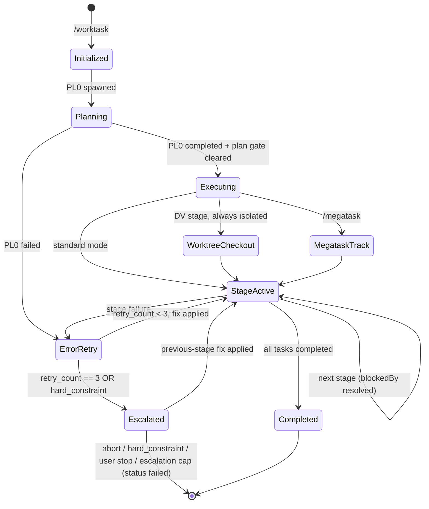
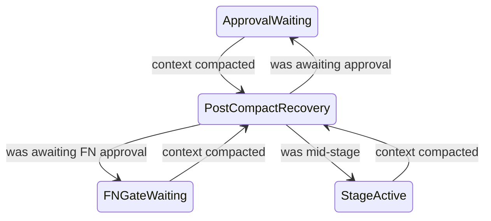

# Lifecycle

Read when executing or checking lifecycle.

Procedure routing: [orchestration](orchestration.md).

Related: [USER under /megatask](workspace-scheduling.md#user-under-megatask)

<!-- canonical-body:start -->
# Worktask System

Resolve bare `scripts/` and `references/` paths from `skills/worktask/`.

## Pipelines

Pipeline shape and stage roles: `skills/worktask/references/worktask-stage-context.md#pipelines`.

### State Machine

#### Post-compact recovery states

#### State-machine references

Stage codes: `skills/worktask/references/stage-codes.md`. Invocation: `skills/worktask/SKILL.md`.
State ledger: `skills/worktask/references/state-ledger.md`.

## Dynamic Worktask Sizing

PL0 assesses complexity and builds the task list from scratch, creating only the stages needed.

### Complexity Assessment

Use `skills/estimation-methodology/SKILL.md#pl0-complexity-score` for the scoring factors and ranges.

### Decision Rules

The score picks the stage set from the tier table in `skills/estimation-methodology/SKILL.md § PL0
Stage-Set & Test-Mode by Complexity Score`; its `§ Stage Inclusion Criteria (PL0 authority)` owns the
AR0/TL0 overrides.

#### Recording skipped and added stages

PL0 stamps `metadata.skipped_stages` (`{stage, reason}`) for every stage of the full 9-stage
pipeline it omits and `metadata.added_stages` (same shape) for every stage beyond the tier default
(`skills/worktask/references/planning-artifacts.md § Dynamic Worktask Sizing (PL0 Stage)`); check 3b validates them.

Security-sensitive features auto-include SR0: authentication/authorization, payment processing, PII
handling, cryptographic operations, external API secrets, file uploads.

Each task carries `metadata.agent` for executor resolution
(`skills/worktask/references/initialization-tasks.md § PL Creates Subsequent Tasks`).

#### Mid-run escalation — the orchestrator is the consumer

A stage may return `requests_stage_escalation` in its artifact `handoff:` frontmatter, and
nothing else reads it. At Step 6.5, after `Agent()` returns and before the `completed` patch,
the orchestrator reads the object; validate it against the four fire conditions, the
stage-validity list, and the structural caps — canonical in
`skills/estimation-methodology/SKILL.md § Mid-run re-sizing`, never restated here; on accept,
create the stage with `state-patch.sh --task-create` / `--task-block` and record `{stage, reason}`
in the existing `metadata.added_stages`; on reject, name the failed condition and continue the run
unchanged. One accepted per run — a second means the plan itself is wrong, so stop at the
human gate instead of growing the pipeline (under `/megatask`, § USER under /megatask). ST0 audits
`added_stages` for escalation entries.
